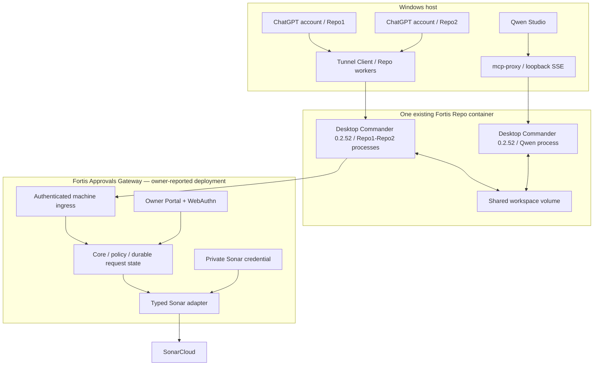

# Fortis architecture

**Snapshot:** 2026-11-05. This is a conceptual map. Individual routes have different evidence levels; use the topic-specific technical documents and dated audits for the evidence and scope of each route.

## High-level view

The current Qwen route is OWNER-REPORTED: Windows `uvx` / `mcp-proxy` exposes a local loopback SSE endpoint and uses `docker exec` to start the original Desktop Commander 0.2.52 entrypoint in this existing container. Qwen runs a separate MCP server process from the ChatGPT Repo1/Repo2 paths, but uses the same installed package version and workspace. The owner-provided Qwen transcript reports 26 tools and successful read/write/edit/move/process operations. See [AI integrations](AI-INTEGRATIONS.md) for the canonical tool catalog and evidence limits.

## ChatGPT → Fortis Repo

The documented route is:

1. ChatGPT invokes the Windows Tunnel / Repo1 or Repo2 worker chain.
2. The Windows-side worker invokes the existing Fortis Repo Docker container.
3. Desktop Commander exposes filesystem, search and process tools to the connected client.
4. The container works inside the shared `fortis-repo-workspace` volume.

Ownership:
- `tunnel` owns Repo1/Repo2 workers, launcher chain and shared `FortisContainerPolicy.ps1`.
- `script-control-center` owns the Script Catalog UI, adapters, resolver and paired updater.
- The Fortis Repo MCP container is a separate runtime; it is not built from the `tunnel` repository.

The current Windows reconnect status is owner-reported in the Tunnel runbook. It was not independently tested from this documentation session.

## Qwen → Fortis Repo

The owner-provided Windows process/log evidence identifies the Qwen route as `uvx` → `mcp-proxy` → local loopback SSE → `docker exec` → the original Desktop Commander 0.2.52 entrypoint. The Qwen process runs as UID/GID 1000 inside the existing Repo container; it does not create another container or use the retained Workfiles gateway as its active server.

The owner-provided Qwen transcript reports 26 tools and successful read/write/process operations. The current Fortis Repo MCP catalog also exposes 26 named tools. A full archived JSON comparison of every tool description and input schema is not available, so exact schema-by-schema identity is not claimed. See [AI integrations](AI-INTEGRATIONS.md).

## Fortis Approvals

Fortis Repo sends typed requests over authenticated TLS to the same Gateway
Core/policy. Accepted routes include Sonar and token-scoped GitHub/native
workspace operations. Upstream API calls use Gateway-held provider credentials;
authorized local workspace jobs execute in the Repo worker and return durable
receipts. The [Gateway agent guide](https://github.com/AlexPastukhh/fortis-approvals/blob/main/docs/GATEWAY-AGENT-GUIDE.md)
owns usage/extension rules; its
[current state](https://github.com/AlexPastukhh/fortis-approvals/blob/main/docs/guides/FORTIS-APPROVALS-SECURE-DEVELOPMENT.md)
owns deployed scope. Source presence alone does not activate another provider.

Owner Portal/WebAuthn is a separate route into the same Fortis Approvals Gateway service. The machine actor can submit an ASK proposal but cannot approve it or call owner routes.

Approval application and private Sonar token are inside Fortis Approvals Gateway, not in the Fortis Repo workspace. The current Gateway deployment and live E2E are OWNER-REPORTED / documented live evidence, not independently inspected with Docker from this session.

## Shared state and trust boundaries

- ChatGPT Repo1, Repo2 and Qwen are documented as client paths into the same Fortis Repo workspace/container; the supplied Qwen command explicitly uses the existing container.
- The Desktop Commander processes serving ChatGPT and Qwen run as Linux UID 1000. They are separate MCP process instances; separate per-client OS identities have not been established.
- `/workspace/repo`, `/workspace/repos` and `/workspace/files` are three mountpoints into one ext4 volume tree, not three independent trust domains.

These boundaries are described separately in [Containers and volumes](CONTAINERS-AND-VOLUMES.md), [Authorization](AUTHORIZATION-AND-APPROVALS.md) and [Future improvements](BACKLOG-IMPROVEMENTS.md).
