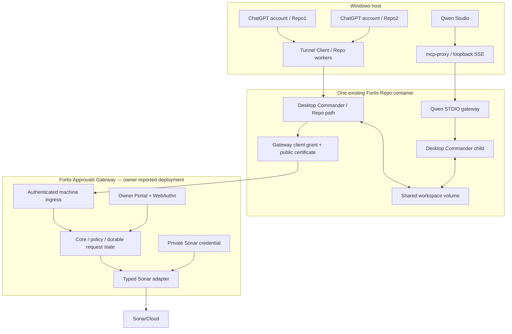

# Fortis architecture

**Snapshot:** 2026-11-03. This is a conceptual map. Individual routes have different evidence levels; see [Current state](CURRENT-STATE.md).

## High-level view

The Qwen proxy transport is OWNER-REPORTED active: the supplied Windows log shows loopback SSE and `docker exec` into this existing container. The owner-provided Qwen chat transcript records 26 tools and successful read/write/edit/move/process operations. Separately, the pinned gateway source exposes only six read-only tools and cannot explain those calls in that exact form. The functional capability is therefore transcript-backed; the precise source-to-session mapping remains a non-blocking provenance question.

## ChatGPT → Fortis Repo

The documented route is:

1. ChatGPT invokes the Windows Tunnel / Repo1 or Repo2 worker chain.
2. The Windows-side worker invokes the existing Fortis Repo Docker container.
3. Desktop Commander exposes filesystem, search and process tools to the connected client.
4. The container works inside the shared `fortis-repo-workspace` volume.

Ownership:
- `tunnel` owns Repo1/Repo2 workers, launcher chain and shared `FortisContainerPolicy.ps1`.
- `script-control-center` owns the Script Catalog UI, adapters, resolver and paired updater.
- The Fortis Repo MCP container is a separate runtime; it is not built from the `tunnel` repository.

The current Windows reconnect status is owner-reported in the Tunnel runbook. It was not independently tested from this documentation session.

## Qwen → Fortis Repo

The owner-provided Windows log shows a local `mcp-proxy` SSE listener and a server command that uses `docker exec` to start `gateway-stdio.mjs` inside the existing Repo container. The gateway runs as UID/GID 1000 and starts a Desktop Commander child; it does not create another container.

The pinned gateway source hash matches the supplied proxy log and its allowlist contains six read-only tools. The owner-provided Qwen chat transcript separately records 26 tools and successful write/process calls. These observations establish practical Qwen functionality but do not establish that the six-tool source served that session. The source-to-session mapping remains a non-blocking provenance question. See [AI integrations](AI-INTEGRATIONS.md).

## Fortis Approvals

The documented live route is Fortis Repo → typed client → TLS 1.3 machine ingress on Fortis Approvals Gateway → Core/policy → Sonar adapter → SonarCloud.

Owner Portal/WebAuthn is a separate route into the same Fortis Approvals Gateway service. The machine actor can submit an ASK proposal but cannot approve it or call owner routes.

Approval application and private Sonar token are inside Fortis Approvals Gateway, not in the Fortis Repo workspace. The current Gateway deployment and live E2E are OWNER-REPORTED / documented live evidence, not independently inspected with Docker from this session.

## Shared state and trust boundaries

- ChatGPT Repo1, Repo2 and Qwen are documented as client paths into the same Fortis Repo workspace/container; the supplied Qwen command explicitly uses the existing container.
- The current Desktop Commander process and Qwen gateway run as Linux UID 1000. Same-UID processes can read files owned by that UID, including the mounted machine grant. Separate per-client OS identities have not been established.
- `/workspace/repo`, `/workspace/repos` and `/workspace/files` are three mountpoints into one ext4 volume tree, not three independent trust domains.
- A read-only MCP tool allowlist does not make the underlying filesystem read-only.
- The Gateway client-auth mount is read-only, but its machine grant remains readable by processes with the relevant UID.
- GitHub PAT storage is outside Git checkout directories but inside the shared workspace volume; it is not isolated from the AI process.

These boundaries are described separately in [Containers and volumes](CONTAINERS-AND-VOLUMES.md), [Authorization](AUTHORIZATION-AND-APPROVALS.md) and [Future improvements](FUTURE-IMPROVEMENTS.md).
